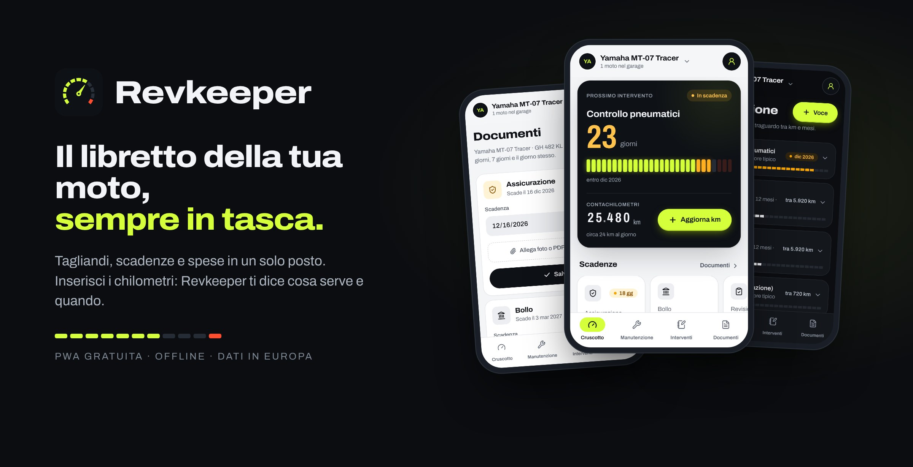
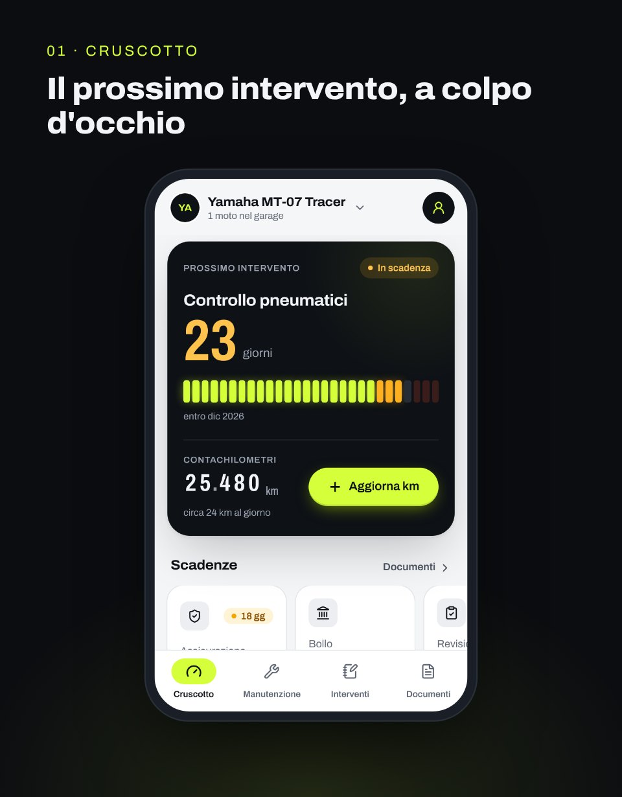
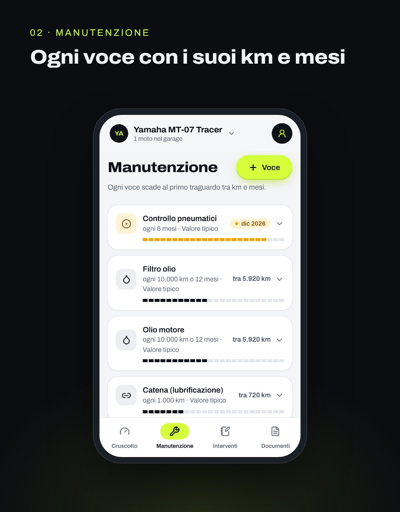
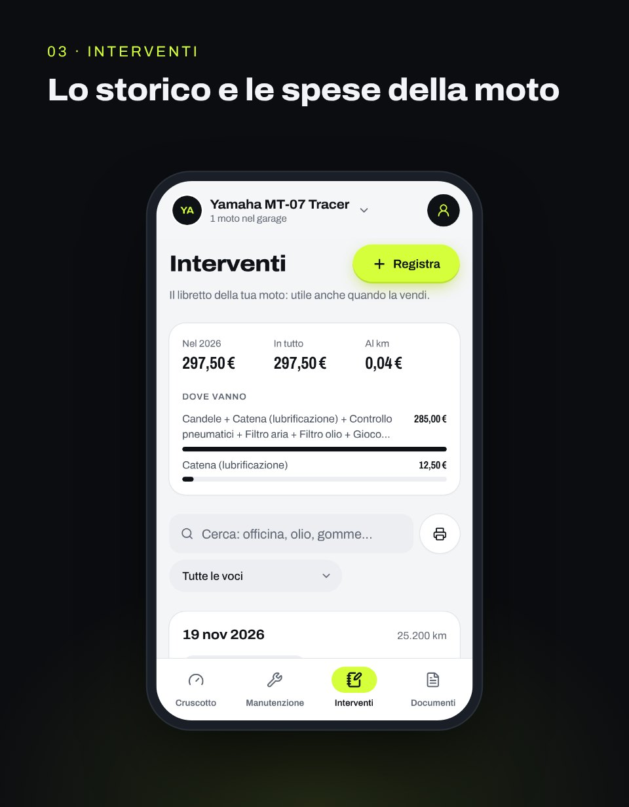
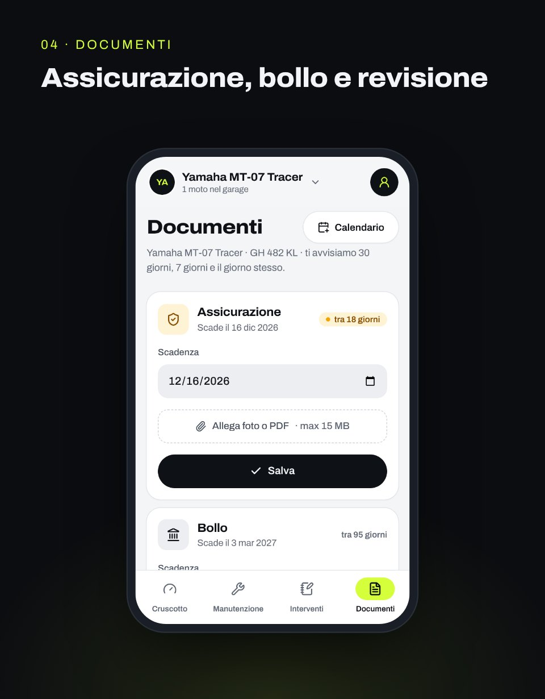
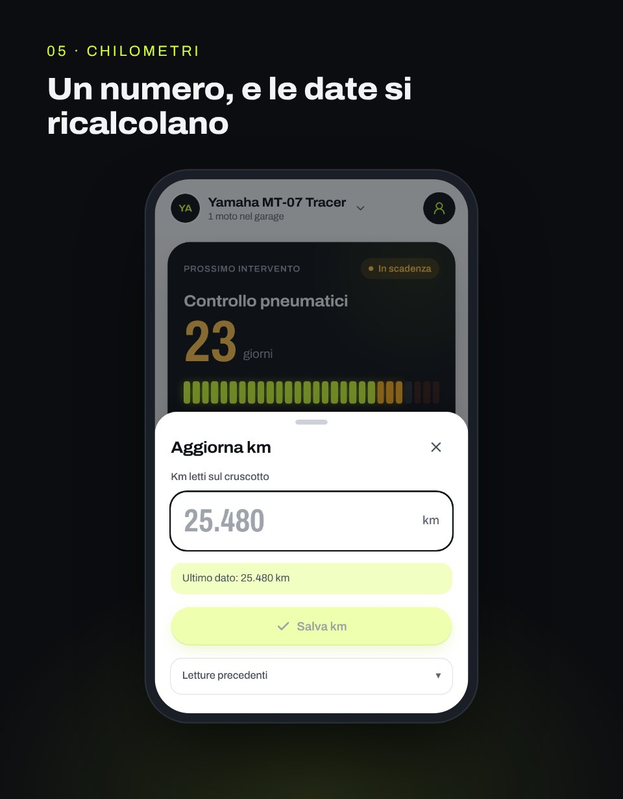
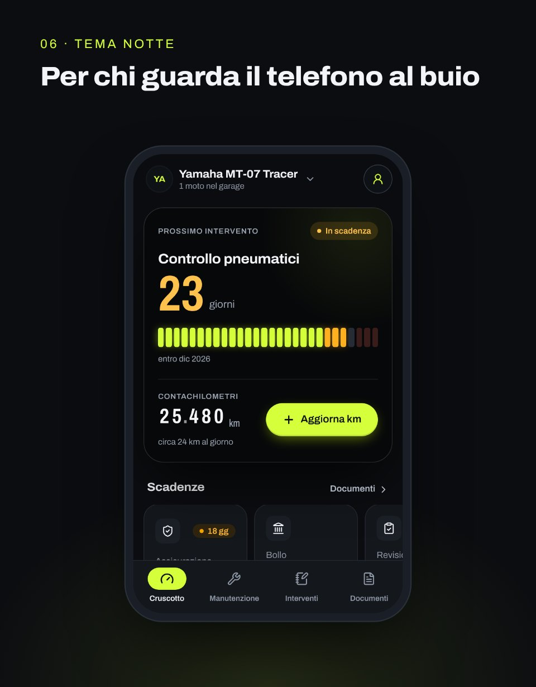

  

  <a href="https://revkeeper.pages.dev"><b>Apri Revkeeper →</b></a>
  &nbsp;·&nbsp; Gratuita &nbsp;·&nbsp; Funziona offline &nbsp;·&nbsp; Senza pubblicità &nbsp;·&nbsp; Dati in Europa

---

**Revkeeper** è il libretto di manutenzione della tua moto, sul telefono. Ricorda per te quando fare il tagliando, cambiare l'olio, lubrificare la catena o rinnovare l'assicurazione. Inserisci i chilometri: lui ti dice cosa serve e quando, prima che diventi un problema.

Si installa dal browser come un'app (PWA), si apre all'istante e funziona anche senza rete.

## In breve

| | |
|---|---|
| **Scadenze sotto controllo** | Tagliandi, revisione, bollo e assicurazione in un solo posto, con promemoria. |
| **Intervalli come da libretto** | Per molti modelli arrivano dal libretto del costruttore; per gli altri, valori tipici del tipo di moto. Puoi cambiarli tutti. |
| **Lo storico della moto** | Ogni intervento con data, km, costo e foto delle ricevute. Utile anche quando la vendi. |
| **Scheda tecnica pronta** | Gomme e pressioni, olio e quantità, liquido freni, candele, targa e telaio. |

## Le funzioni

<table>
  <tr>
    <td width="50%"></td>
    <td width="50%"></td>
  </tr>
  <tr>
    <td valign="top">
      <h3>Cruscotto</h3>
      Il prossimo intervento in grande, con i km o i giorni che mancano e una barra a segmenti come un contagiri: lime quando è tutto a posto, ambra quando si avvicina, rosso quando è scaduto. Sotto, il contachilometri, i km medi al giorno e le scadenze dei documenti.
    </td>
    <td valign="top">
      <h3>Manutenzione</h3>
      Olio, filtri, catena, freni, candele, valvole: per ogni voce vedi quanti km o mesi mancano e una data stimata su come usi la moto. Le più urgenti stanno in cima. A ogni voce puoi aggiungere una nota (tipo d'olio, codice del filtro, coppie di serraggio).
    </td>
  </tr>
  <tr>
    <td width="50%"></td>
    <td width="50%"></td>
  </tr>
  <tr>
    <td valign="top">
      <h3>Interventi</h3>
      Registra cosa hai fatto, a quanti km e quanto hai speso, con foto o PDF di fatture e ricevute. Cerca per parola, anno o voce. Le spese si leggono per anno, per voce e al km. Con <b>PDF</b> stampi il libretto completo.
    </td>
    <td valign="top">
      <h3>Documenti</h3>
      Scadenze di assicurazione, bollo e revisione, con il documento allegato. Con <b>Calendario</b> le mandi nel calendario del telefono, con un promemoria 7 giorni prima e la mattina stessa.
    </td>
  </tr>
  <tr>
    <td width="50%"></td>
    <td width="50%"></td>
  </tr>
  <tr>
    <td valign="top">
      <h3>Chilometri in un tocco</h3>
      Scrivi i km del cruscotto e tutte le date si ricalcolano. Un numero sbagliato si cancella da <b>Letture precedenti</b>.
    </td>
    <td valign="top">
      <h3>Tema Notte</h3>
      Chiaro, Notte o come il telefono, da Account → Aspetto. Il cruscotto resta nero in entrambi, come una strumentazione vera.
    </td>
  </tr>
</table>

### E poi

- **Garage:** una o più moto. Scegli marca, modello e anno dagli elenchi e la scheda si compila da sola con cilindrata, potenza, peso, gomme e olio consigliati. Aggiungi una foto e sistemala con zoom e spostamento.
- **Promemoria:** attiva le notifiche e scegli l'ora. Revkeeper ti avvisa 30 giorni, 7 giorni e il giorno stesso di una scadenza, e quando una manutenzione si avvicina ai km previsti.
- **Più telefoni:** con l'accesso Google il garage si salva online e lo ritrovi su un altro telefono.

## Come iniziare

1. Apri **[revkeeper.pages.dev](https://revkeeper.pages.dev)** dal telefono.
2. Installala sulla schermata Home:
   - **Android (Chrome):** menu ⋮ → *Installa app*
   - **iPhone (Safari):** tasto Condividi → *Aggiungi alla schermata Home*
3. Aggiungi la tua moto e i chilometri attuali.
4. Ogni tanto aggiorna i km: al resto pensa Revkeeper.

Quando esce una versione nuova l'app mostra **Aggiornamento disponibile**: tocca **Aggiorna**, oppure continua e la nuova versione parte alla prossima apertura.

## Domande frequenti

**Devo creare un account?**
No. L'app funziona subito e i dati restano sul tuo telefono. Se accedi con Google, i dati si salvano anche online e li ritrovi su un altro telefono.

**Funziona senza internet?**
Sì. Puoi consultare e aggiornare tutto anche offline; quando torni online i dati si sincronizzano da soli.

**Quanto costa?**
Niente. Revkeeper è gratuita e senza pubblicità.

**La mia moto non è nell'elenco.**
Scrivi marca e modello a mano: funziona lo stesso. L'elenco dei modelli si aggiorna ogni tre mesi.

**I valori di manutenzione sono affidabili?**
Quando arrivano dal libretto ufficiale l'app lo indica. In ogni caso fa fede il libretto della tua moto: puoi modificare ogni intervallo.

**Che fine fanno i miei dati?**
Restano tuoi. Non vengono venduti né condivisi, e quelli online stanno su server in Europa. Da **Account** scarichi una copia di tutto (moto, interventi, documenti e file) ed elimini l'account quando vuoi. Senza account, foto e PDF restano solo sul telefono; se attivi le notifiche, una copia anonima di moto e scadenze serve al server per i promemoria, e da Account la scarichi o la elimini. I dettagli sono nell'[informativa privacy](https://revkeeper.pages.dev/privacy).

**Ho trovato un problema di sicurezza.**
Scrivi all'indirizzo in [SECURITY.md](SECURITY.md), non aprire una issue pubblica.

---

Per chi sviluppa: [note per lo sviluppo](docs/SVILUPPO.md) · [ripristino in caso di guasto](RIPRISTINO.md) · [design system](design/SPEC.md).

Elenco dei modelli basato su dati pubblici: NHTSA vPIC; Traficom, Agenzia finlandese dei trasporti e delle comunicazioni ([CC BY 4.0](https://creativecommons.org/licenses/by/4.0/)); Dirección General de Tráfico (Spagna); Ufficio federale delle strade (USTRA/ASTRA, Svizzera, su autorizzazione). I file in `data/` e `src/data/catalog/` sono dati **elaborati e aggregati per modello** (date in `_brands.json`), forniti senza garanzia di esattezza; nessuna fonte partecipa a Revkeeper né lo sostiene. Marchi e nomi dei modelli appartengono ai rispettivi proprietari. Le schermate mostrano dati di esempio.
